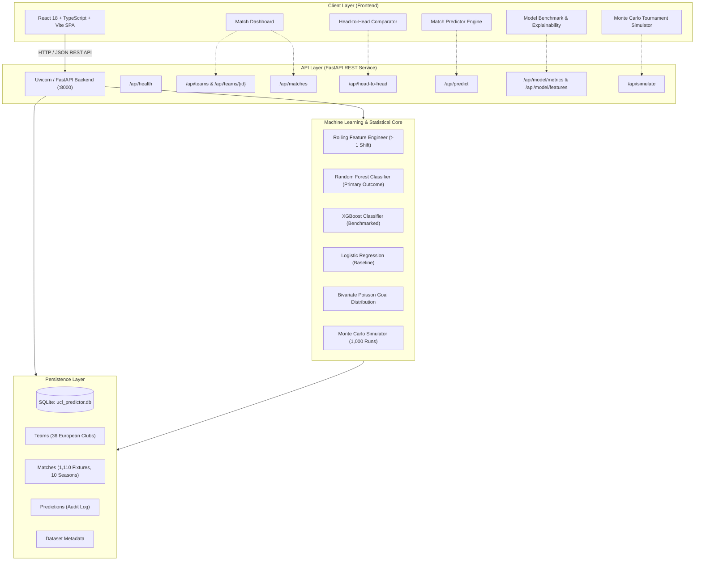
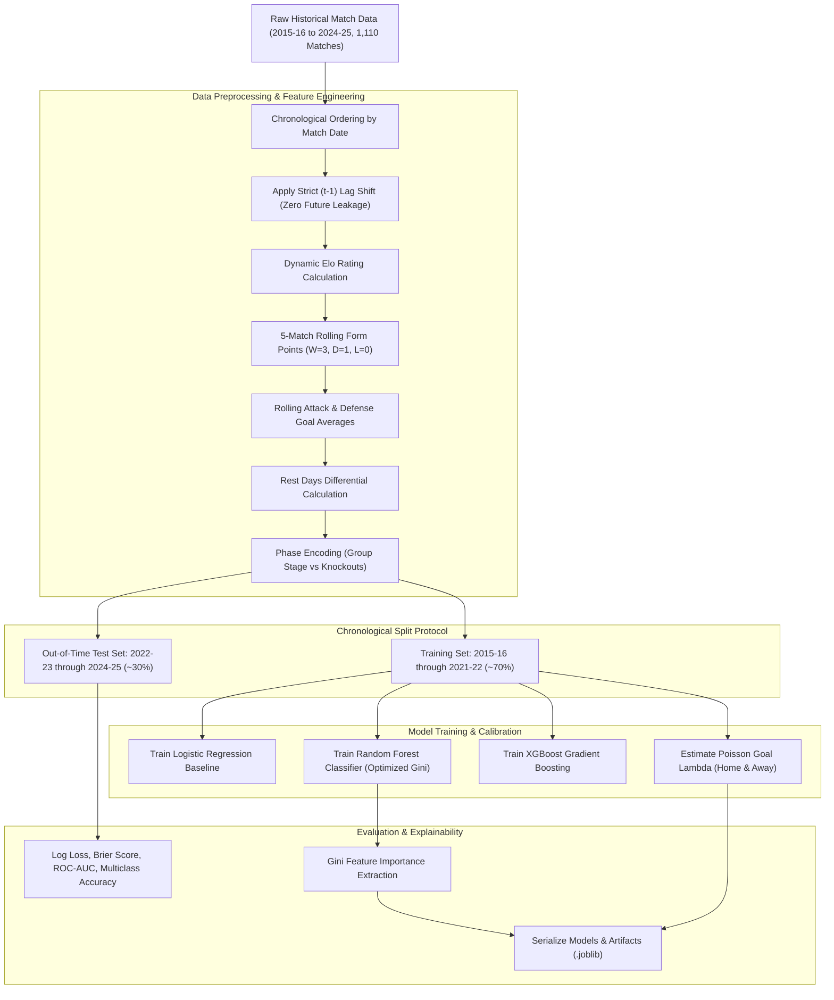
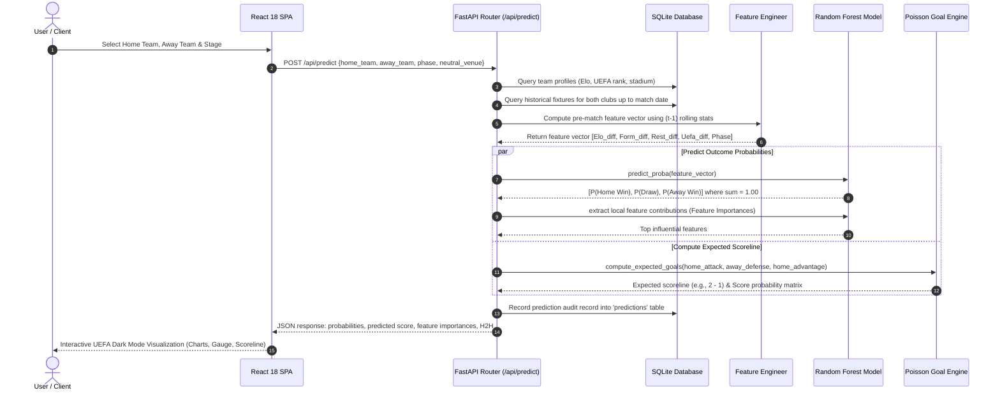
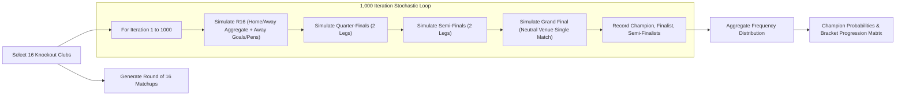
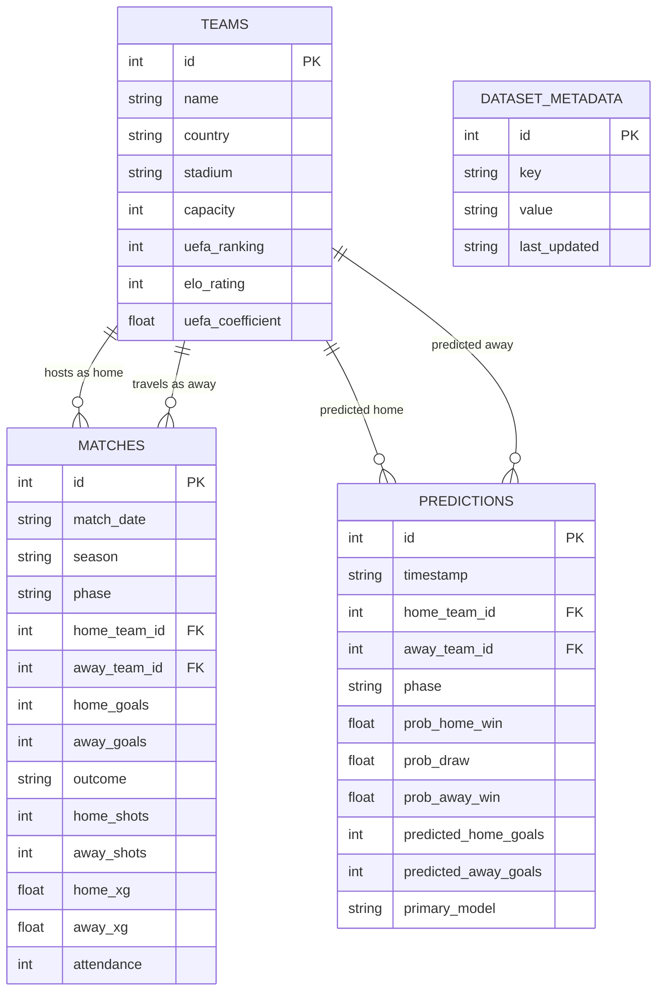

# System Architecture & Data Flow — UEFA Champions League AI Match Outcome Predictor

This document details the end-to-end system architecture, machine learning pipeline, data flow, inference mechanisms, and tournament simulation flow for the **UEFA Champions League AI Match Outcome Predictor**.

---

## 1. High-Level System Architecture



---

## 2. End-to-End Machine Learning Pipeline



---

## 3. Real-Time Prediction Request & Inference Flow

When a user selects two clubs in the frontend Match Predictor, the following request-response lifecycle executes:



---

## 4. Monte Carlo Tournament Simulation Flow

The application features a 1,000-run Monte Carlo tournament simulation engine capable of modeling dynamic knockout brackets:



---

## 5. Database Schema & Entity-Relationship Flow



---

## 6. Directory Structure & Execution Boundaries

```
project 2.0/
├── backend/
│   ├── app/
│   │   ├── main.py              # FastAPI entry point & CORS configuration
│   │   ├── database.py          # SQLAlchemy connection & session management
│   │   ├── seed_db.py           # Database seeding (1,110 matches & 36 teams)
│   │   ├── models/              # SQLAlchemy ORM entity definitions
│   │   ├── schemas/             # Pydantic v2 validation models
│   │   └── routes/              # Modular REST endpoint controllers
│   ├── ml/
│   │   ├── features.py          # Strict (t-1) rolling feature generator
│   │   ├── train.py             # Chronological split training routine
│   │   ├── predict.py           # Prediction inference engine
│   │   └── goal_model.py        # Independent Poisson scoreline distribution
│   ├── tests/
│   │   └── test_api.py          # Pytest validation suite
│   ├── requirements.txt         # Python dependencies
│   └── ucl_predictor.db        # Persisted SQLite database
│
├── frontend/
│   ├── src/
│   │   ├── components/          # Reusable UEFA glassmorphic UI components
│   │   ├── pages/               # Views: Dashboard, Predictor, Compare, Simulate, etc.
│   │   ├── services/            # Axios / Fetch client calling FastAPI
│   │   ├── types/               # TypeScript interfaces matching backend schemas
│   │   └── App.tsx              # Application layout & navigation
│   ├── package.json             # React 18, Vite, Tailwind CSS dependencies
│   ├── tailwind.config.js       # UEFA Midnight & Electric Blue color tokens
│   └── vite.config.ts           # Vite development server configuration
│
├── FLOW.md                      # Architecture, Pipeline & Execution flow diagrams
└── README.md                    # Project documentation, methodology & commands
```
